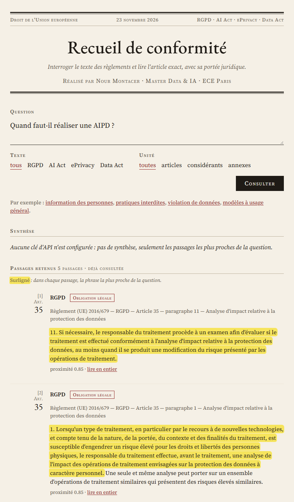
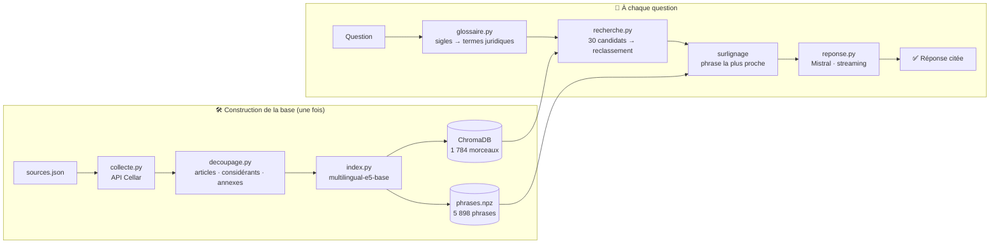

<div align="center">



<br>


**Assistant RAG sur le droit européen des données et de l'IA**<br>
RGPD · AI Act · directive ePrivacy · Data Act

*Chaque réponse cite l'article exact **et** dit si la source oblige ou recommande.*

[🎯 Utilité](#-à-quoi-ça-sert) ·
[🖼️ Aperçu](#️-aperçu) ·
[🏗️ Architecture](#️-architecture) ·
[📚 Ressources](#-ressources-utilisées) ·
[📊 Résultats](#-mesures-et-performances) ·
[📄 Rapport](#-rapport-complet) ·
[🚀 Lancer](#-lancer-le-projet)

</div>

---

## 🎯 À quoi ça sert

Les textes européens sur les données et l'IA font des centaines de pages. Une question simple
comme *« Mon site a été piraté, qui dois-je prévenir ? »* ne contient aucun des mots du
règlement, qui parle de *« violation de données à caractère personnel »* et de *« notification
à l'autorité de contrôle »*. Un moteur de recherche plein texte ne trouve rien. Un chatbot
généraliste répond, mais sans citer sa source ni dire si elle est contraignante.

Ce projet fait les deux à la fois :

| | |
|---|---|
| 🔎 **Retrouve** | les passages pertinents, même formulés en langage courant ou en sigles (AIPD, DPO, GPAI…) |
| ⚖️ **Qualifie** | chaque source : obligation légale, recommandation d'autorité ou cadre éthique |
| 🖍️ **Surligne** | dans chaque passage, la phrase qui répond le plus directement à la question |
| ✍️ **Rédige** | une synthèse qui n'utilise **que** ces passages, citée `[1]`, `[2]`… |
| 🙅 **Sait se taire** | répond « je ne sais pas » quand les textes ne tranchent pas |

> [!IMPORTANT]
> **Cadrage.** L'outil oriente dans les textes, il ne qualifie rien juridiquement. Il ne dit
> pas si un système est à haut risque : il montre les articles qui le définissent.

---

## 🖼️ Aperçu

<div align="center">

<br><sub>Question « Quand faut-il réaliser une AIPD ? » : l'article 35 du RGPD arrive en tête, la phrase clé est surlignée.</sub>
</div>

---

## 🏗️ Architecture

<div align="center">

</div>

<details>
<summary><b>🧭 Voir le schéma détaillé (cliquer)</b></summary>

<br>



</details>

<details>
<summary><b>⚙️ Le rôle de chaque fichier</b></summary>

<br>

| Étape | Fichier | Rôle |
|---|---|---|
| 📥 Collecte | `collecte.py` | Télécharge une fois les textes déclarés dans `sources.json`, via l'API Cellar de l'Office des publications |
| ✂️ Découpage | `decoupage.py` | Un morceau par article, considérant ou annexe ; les articles longs sont redécoupés par paragraphe |
| 🧮 Indexation | `index.py` | Vectorise les morceaux nouveaux ou modifiés et les range dans ChromaDB avec leurs étiquettes |
| 🔎 Recherche | `recherche.py` | Retrouve les passages pertinents ; `glossaire.py` et `motscles.py` l'assistent |
| 🖍️ Surlignage | `phrases.py` | Repère, dans chaque passage, la phrase la plus proche de la question |
| ✍️ Rédaction | `reponse.py` | Fait rédiger une réponse qui n'utilise que les passages et les cite, en streaming |
| 📏 Évaluation | `evaluation.py` | Mesure si les bons articles sont retrouvés, avec étude d'ablation |
| 🌐 Interface | `app.py`, `web/` | Page web de consultation (FastAPI) |

</details>

<details>
<summary><b>💡 Les choix techniques et leurs raisons</b></summary>

<br>

**✂️ Découpage par unité juridique.** Un article est une unité de sens complète et son numéro
donne une citation exacte. Un découpage tous les 1000 caractères couperait des phrases et
rendrait la citation impossible. Au-delà de 2500 caractères (l'article 3 de l'AI Act, avec ses
68 définitions, en fait 19 000), l'article est redécoupé par paragraphe : un vecteur calculé
sur un texte trop long devient flou.

**🏷️ En-tête dans le vecteur.** Un paragraphe isolé (« 3. Le délai visé au paragraphe 1… »)
n'a pas de sujet. Le texte vectorisé est précédé de sa référence complète (règlement, article,
titre) ; le texte affiché reste le corps seul.

**🧠 Embeddings `multilingual-e5-base`.** Modèle multilingue qui tourne en local, adapté au
français, sans coût par requête. La famille e5 impose les préfixes `passage:` et `query:`.

**🗄️ ChromaDB.** Base vectorielle persistante sur disque, sans serveur, avec filtrage par
métadonnées intégré. Distance cosinus sur vecteurs normalisés.

**📖 Analyse de la question avant la recherche.**
- *Glossaire* : « AIPD », « cookie », « piraté » sont complétés par la formulation des textes.
- *Références explicites* : « Que dit l'article 22 ? » va chercher l'article directement, car un
  numéro seul n'a pas de sens pour un vecteur. Un texte nommé (« … de l'AI Act ? ») devient un filtre.
- *Priorité aux articles* : un considérant explique l'intention du législateur sans obliger ;
  à pertinence proche, l'article qui pose la règle passe devant.
- *Diversité* : au plus deux morceaux d'un même article dans les résultats.

**🧪 Recherche hybride BM25 testée puis écartée.** Fusionnée avec les vecteurs, elle fait
*baisser* le score sur mes questions (voir l'ablation). Elle reste disponible
(`Recherche(hybride=True)`) mais n'est pas activée.

**✍️ Mistral, avec repli sur gpt-4o-mini.** Bon en français, fournisseur européen. Les deux
exposent la même API, donc un seul code d'appel. Température 0,1 : on attend une reformulation
fidèle, pas de la créativité.

**🛡️ Garde-fous du prompt.** N'utiliser que les passages fournis, citer chaque affirmation,
préciser la nature de la source, répondre « je ne sais pas » si les textes ne tranchent pas,
ne jamais qualifier juridiquement une situation.

</details>

---

## 📚 Ressources utilisées

### 📜 Corpus : 4 textes intégraux

| Texte | Version indexée | Morceaux |
|---|---|---:|
| 🇪🇺 [RGPD — règlement (UE) 2016/679](https://eur-lex.europa.eu/legal-content/FR/TXT/HTML/?uri=CELEX:32016R0679) | Journal officiel du 4 mai 2016 | 480 |
| 🤖 [AI Act — règlement (UE) 2024/1689](https://eur-lex.europa.eu/legal-content/FR/TXT/HTML/?uri=CELEX:32024R1689) | Journal officiel du 12 juillet 2024 | 823 |
| 🍪 [ePrivacy — directive 2002/58/CE](https://eur-lex.europa.eu/legal-content/FR/TXT/HTML/?uri=CELEX:02002L0058-20091219) | Version consolidée de 2009 (règle sur les cookies) | 89 |
| 🔌 [Data Act — règlement (UE) 2023/2854](https://eur-lex.europa.eu/legal-content/FR/TXT/HTML/?uri=CELEX:32023R2854) | Journal officiel du 22 décembre 2023 | 392 |
| | **Total : articles, considérants et annexes** | **1 784** |

### 🧰 Bibliothèques et outils

| Outil | Rôle dans le projet | Pourquoi ce choix |
|---|---|---|
| 🐍 **Python 3.11+** | tout le pipeline | écosystème de référence pour le traitement du langage |
| 🌐 **requests** + **Cellar API** | téléchargement des textes officiels | EUR-Lex bloque les robots ; Cellar est l'accès officiel de l'Office des publications |
| 🥣 **BeautifulSoup** + **lxml** | extraction du texte HTML | robuste aux balises irrégulières d'EUR-Lex |
| 🤗 **sentence-transformers** | modèle `intfloat/multilingual-e5-base` | local, gratuit, bon en français |
| 🗄️ **ChromaDB** | base vectorielle | sur disque, sans serveur, filtres par métadonnées |
| 🔢 **NumPy** | vecteurs des phrases (surlignage) | produit matriciel instantané, stockage compact en float16 |
| ⚡ **FastAPI** + **Uvicorn** | serveur web et API | streaming natif, validation des entrées par Pydantic |
| 📡 **httpx** | appel au modèle de rédaction | streaming SSE, une seule API pour Mistral et OpenAI |
| ✍️ **Mistral** (`mistral-small`) | rédaction de la synthèse | européen, bon en français ; repli `gpt-4o-mini` |
| 🧪 **pytest** | 64 tests automatiques | standard Python |
| 🎨 **HTML / CSS / JavaScript** | interface | sans framework : une page, chargement immédiat |

---

## 📊 Mesures et performances

### 📏 Les métriques

| Métrique | Définition | Ce qu'elle dit |
|---|---|---|
| 🎯 **Réussite @5** | part des questions dont au moins un bon passage figure dans les 5 premiers | *l'utilisateur trouve-t-il la réponse dans ce qu'on lui montre ?* |
| 🥇 **MRR** | moyenne de $\frac{1}{\text{rang du premier bon passage}}$ : 1 s'il est premier, 0,5 s'il est deuxième… | *la bonne réponse arrive-t-elle en haut ?* |
| 📐 **Similarité cosinus** | angle entre le vecteur de la question et celui du passage | proximité de sens, sert au classement et au surlignage |
| ⏱️ **Temps de réponse** | médiane mesurée côté serveur | *l'outil est-il utilisable en direct ?* |

$$\text{MRR} = \frac{1}{|Q|}\sum_{q \in Q} \frac{1}{\text{rang}_q}$$

### 🔬 Étude d'ablation : ce que chaque amélioration apporte

<div align="center">

</div>

<details>
<summary><b>📋 Tableau des valeurs</b></summary>

<br>

| Configuration (ajouts cumulés) | Réussite @5 | MRR |
|---|---:|---:|
| Vecteurs seuls | 68,2 % | 0,527 |
| + glossaire | 81,8 % | 0,652 |
| + références explicites | 86,4 % | 0,674 |
| + priorité aux articles | **95,5 %** | **0,702** |
| + diversité ✅ *retenue* | 95,5 % | 0,702 |
| + hybride BM25 ❌ *écartée* | 90,9 % | 0,693 |

```
.venv\Scripts\python -m conformite.evaluation --fichier tests/questions/questions_mise_au_point.json --ablation
```

</details>

> [!NOTE]
> **Honnêteté de la mesure.** Ces 95,5 % sont obtenus sur les 24 questions pièges (langage
> courant, sigles, négations, numéros seuls, hors corpus) qui ont servi à **régler** la
> recherche : ils sont optimistes par construction. La mesure de référence est un jeu de test
> séparé (`tests/questions/questions.json`), jamais utilisé pour le réglage.

### ⚡ Temps de réponse

| Étape | Mesure | Comment |
|---|---:|---|
| 🔎 Passages | **92 ms** | modèle chargé et « échauffé » au démarrage |
| ♻️ Question déjà posée | **0 ms** | cache des 256 dernières questions |
| 🖍️ Surlignage | **2 ms** *(2 à 5 s avant)* | phrases vectorisées une fois pour toutes à l'indexation |
| ✍️ Synthèse | dès les premiers mots | streaming : le texte s'affiche pendant sa rédaction |
| 🔁 Réindexation | seuls les morceaux modifiés | empreinte SHA-1 de chaque morceau comparée à la base |

<sub>Mesures sur un ordinateur portable, sans carte graphique.</sub>

### 🚫 Questions hors corpus

Le meilleur passage d'une question sans réponse (taux de TVA, durée de vie d'un cookie selon
la CNIL) obtient une similarité de **0,81 à 0,84**, au même niveau que les bonnes réponses. Un
seuil de score ne suffit donc pas pour dire « je ne sais pas » : c'est le rôle du prompt de
rédaction.

---

## 📄 Rapport complet

<div align="center">

### [📥 Lire le rapport PDF (13 pages)](docs/rapport.pdf)

</div>

Architecture, démarche étape par étape, métriques et formules, résultats chiffrés, les neuf
problèmes rencontrés et leur solution, limites et perspectives, détail des 24 questions
d'évaluation.

---

## 🚀 Lancer le projet

**Sous Windows**, avec Python 3.11 ou plus récent : double-cliquer sur **`lancer.bat`**.

```
 Recueil de conformite
 ---------------------
   1. Ouvrir l'interface              (par defaut)
   2. Reconstruire la base             (telechargement, decoupage, indexation)
   3. Mesurer la qualite de la recherche
```

⏳ La première fois, il crée l'environnement Python, télécharge les textes et construit la
base (environ 40 minutes sans carte graphique). Ensuite, l'interface s'ouvre dans le
navigateur en une vingtaine de secondes.

<details>
<summary><b>🔧 Installation et commandes à la main</b></summary>

<br>

Dans un terminal ouvert à la racine du projet :

```
python -m venv .venv
.venv\Scripts\python -m pip install -r requirements.txt
copy .env.example .env
```

Puis renseigner `MISTRAL_API_KEY` dans `.env`. Sans clé, tout fonctionne sauf la synthèse :
l'interface affiche alors les passages seuls.

```
.venv\Scripts\python -m conformite.collecte            # télécharge les textes (une seule fois)
.venv\Scripts\python -m conformite.decoupage           # produit data/morceaux.jsonl
.venv\Scripts\python -m conformite.index               # vectorise (environ 40 min la première fois)
.venv\Scripts\python -m conformite.index --phrases     # facultatif : surlignage instantané
.venv\Scripts\python -m conformite.app --ouvrir        # interface web
```

En ligne de commande :

```
.venv\Scripts\python -m conformite.recherche "systeme a haut risque" --source ai-act -k 3
.venv\Scripts\python -m conformite.reponse "Dans quel delai notifier une violation de donnees ?"
```

</details>

---

## 🧪 Tests

**64 tests automatiques**, tous au vert ✅

```
.venv\Scripts\python -m pytest                   # tout (environ 1 min)
.venv\Scripts\python -m pytest -m "not corpus"   # sans la base : 5 secondes
```

<details>
<summary><b>🔍 Ce que vérifie chaque fichier</b></summary>

<br>

| Fichier | Ce qui est vérifié |
|---|---|
| `test_decoupage.py` | types d'unités, « 14 bis », numéro seul sur sa ligne, sous-découpage, identifiants uniques |
| `test_glossaire.py` | sigles, accords (« piratés »), mots entiers, textes et articles cités dans la question |
| `test_motscles.py` | normalisation des mots, classement BM25, poids des mots rares |
| `test_phrases.py` | positions exactes des phrases surlignées |
| `test_evaluation.py` | `rgpd-article-35-par-7` valide `rgpd-article-35`, pas `rgpd-article-350` |
| `test_index.py` | indexation incrémentale : seuls les morceaux nouveaux ou modifiés sont revectorisés |
| `test_reponse.py` | passages numérotés, nature juridique, consigne de cadrage présente |
| `test_app.py` | API web avec une fausse recherche : cache, validation, article recomposé dans l'ordre |
| `test_recherche.py` | filtres ; sur la vraie base : questions de référence, diversité, surlignage |

Les tests marqués `corpus` chargent le modèle et la base ; ils sont ignorés si la base n'a
pas encore été construite.

</details>

---

## 🗂️ Organisation du dépôt

<details>
<summary><b>📁 Arborescence</b></summary>

<br>

```
rag-conformite/
├── conformite/          code Python
│   ├── collecte.py      téléchargement des textes officiels
│   ├── decoupage.py     découpage en articles, considérants, annexes
│   ├── index.py         vectorisation et base ChromaDB
│   ├── phrases.py       vecteurs des phrases, pour le surlignage
│   ├── glossaire.py     sigles et langage courant -> vocabulaire juridique
│   ├── motscles.py      recherche BM25 (testée, désactivée)
│   ├── recherche.py     recherche des passages
│   ├── reponse.py       rédaction de la réponse citée
│   ├── evaluation.py    mesure de la qualité de la recherche
│   ├── app.py           serveur web
│   └── chemins.py       chemins du projet
├── web/                 interface : HTML, CSS, JavaScript
├── config/sources.json  textes indexés et leurs étiquettes
├── tests/               tests automatiques (pytest)
│   ├── decoupage/       échantillons pour tester le découpage
│   └── questions/       jeux de questions d'évaluation
├── notebooks/           démonstration
├── docs/                rapport PDF et illustrations
└── lancer.bat           lancement en un double-clic
```

`data/` et `db/` sont générés par le pipeline et ne sont pas versionnés.

</details>

---

## ⚠️ Limites et suites possibles

- 📑 Les recommandations de la CNIL et les cadres éthiques ne sont pas encore indexés (les
  étiquettes `recommandation` et `ethique` existent déjà).
- 🗓️ Le RGPD est indexé dans sa version du Journal officiel de 2016, sans le rectificatif de 2018.
- 📖 Le glossaire est écrit à la main : un sigle qu'il ne connaît pas n'est pas traduit.
- 📏 L'évaluation porte sur la recherche, pas sur la qualité de la rédaction.

---

<div align="center">

**👤 Nour Montacer**<br>
Projet personnel · module Gen IA · Master Data & IA · ECE Paris

<sub>Sources : Journal officiel de l'Union européenne, via EUR-Lex.</sub>

</div>
